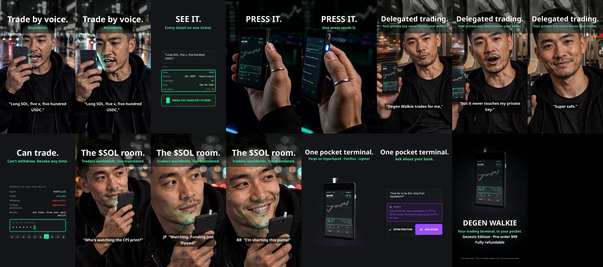

# okaypic-ads-skill

A [Claude Code](https://claude.com/claude-code) skill (also works with Codex and other agents that
read `SKILL.md`) for making **product video ads with an AI actor who holds and uses your product**,
through the [okaypic.com](https://okaypic.com) API.

You give it a product description and a few product photos. The agent interviews you about the
product, offers the key features, taglines and stories to choose from (or write your own),
casts an AI actor, shows you every keyframe for approval, renders the clips with MiniMax H3
(voices and sound included) and cuts a finished ad with supers, captions and an end card, in
9:16, 16:9 and 1:1.

## Example: Degen Walkie · 34 s · under US$1 in API calls

[](https://okaypic.b-cdn.net/marketing/degen-walkie/degen_walkie_9x16.mp4)

**Watch:** [9:16](https://okaypic.b-cdn.net/marketing/degen-walkie/degen_walkie_9x16.mp4) ·
[16:9](https://okaypic.b-cdn.net/marketing/degen-walkie/degen_walkie_16x9.mp4) —
brief, shots and cut in `examples/degen-walkie/`.

```
describe + photos → questions → feature → tagline → story → actor → script
   ad.json                                                  actors.py   shots.json / cut.json

→ product sheet → keyframes (you approve) → clips (H3) → cut → 9:16 / 16:9 / 1:1
  product_sheet.py   gen_frames.py           gen_clips.py   cut_ad.py
```

## Install

```bash
npx skills add shipunyc/okaypic-ads-skill          # any agent that reads SKILL.md (skills.sh)
# or by hand, for one project
git clone https://github.com/shipunyc/okaypic-ads-skill .claude/skills/okaypic-ads
# or for every project
git clone https://github.com/shipunyc/okaypic-ads-skill ~/.claude/skills/okaypic-ads
```

Then in Claude Code: *"make a 30-second ad for my product"* and attach or point to the photos.

Requirements: Python 3.9+, `ffmpeg` + `ffprobe` on PATH, an okaypic API key
(`OKAYPIC_API_KEY` in the environment or a `.env` file). Get a key at
https://okaypic.com/api-docs . New accounts get a small free credit; top up from US$2.

## Preset actors

Six AI-generated actors (no real people), each with a reference sheet and a fixed voice in
English, Chinese and Japanese, so the same actor looks and sounds the same in every ad:

```bash
python scripts/actors.py list
python scripts/actors.py use myad maya --lang en
```

The list is public: `GET https://okaypic.com/api/actors`; the full voice library is
`GET https://okaypic.com/api/voices?lang=en`. You can also use your own photo and voice
(`actors.py custom`), of people who agreed to it.

## Use the scripts without an agent

```bash
export OKAYPIC_API_KEY=...
python scripts/fetch_fonts.py myad/assets
python scripts/product_sheet.py myad          # ad.json images -> refs/product.png
python scripts/actors.py use myad leo         # refs/actor_leo.png + refs/voice_leo.mp3
python scripts/gen_frames.py myad             # keyframes -> frames/review.jpg
python scripts/gen_frames.py myad --approve 01 02
python scripts/gen_clips.py myad --quote      # what the clips will cost
python scripts/gen_clips.py myad              # takes/<shot>_<a|b>.mp4 + contact sheets
python scripts/cut_ad.py myad                 # out/<name>_9x16.mp4, _16x9, _1x1
```

Formats: `docs/ad-format.md`, `docs/shots-format.md`, `docs/cut-format.md`; prompting rules:
`docs/prompting.md`.

## Costs (okaypic list prices, Oct 2026)

| Step | Price |
|---|---|
| Keyframe or actor sheet (gpt-image-2) | US$0.03 |
| MiniMax H3 clip, 768p | US$0.01 per second → US$0.05 for 5 s |
| Preset actors, voices, product sheet, cut | free |

A 30 s ad with 4–5 keyframes and 4–5 shots × 2 takes is about US$0.60–0.80. Failed tasks are
refunded; re-running a script never charges twice for the same request.

## Related

[okaypic-video-skill](https://github.com/okaypic/okaypic-video-skill): short films and episodic
series with the same API.

## License

MIT. Fonts fetched by `fetch_fonts.py` are Noto (SIL Open Font License).
